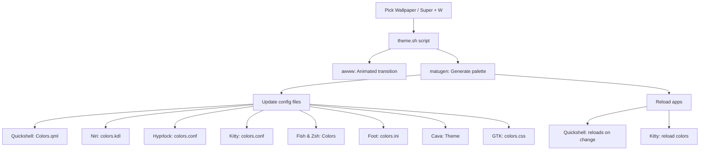

# Dotfiles: Niri on Arch Linux

My personal desktop setup on Arch Linux using the [Niri](https://github.com/YaLTeR/niri) scrollable tiling window manager. Colors update automatically from the wallpaper, and the terminal setup uses both Zsh and Fish.

> **Live site:**
> **[arch.masum.tech](https://arch.masum.tech)**

---

> [!NOTE]
> **Branches**
>
> | Branch | What is in it |
> | :--- | :--- |
> | `main` | This branch. Niri and Quickshell, what I use now. |
> | [`legacy-waybar`](https://github.com/insaneodyssey26/dotfiles/tree/legacy-waybar) | Niri with Waybar, SwayNC and Fuzzel, from before I moved to Quickshell. |
> | [`hyprland-archive`](https://github.com/insaneodyssey26/dotfiles/tree/hyprland-archive) | My full Hyprland setup, with Lua configs. Not updated anymore. |
> | [`experiment`](https://github.com/insaneodyssey26/dotfiles/tree/experiment) | Older Hyprland and Waybar tests. Not updated anymore. |
>
> I moved from Hyprland to Niri, and later from Waybar to Quickshell. Anything for those old setups is in the branches above, so it is not in `main`.

---

## Screenshots

### Desktop


### Theme & Components


---

## What's Inside

*   **Scrollable Tiling**: Infinite horizontal workspace ribbon powered by Niri.
*   **Dynamic Colors**: Wallpaper colors extracted on the fly using Matugen.
*   **Smooth Wallpapers**: Animated transitions using `awww`.
*   **Dual Shells**: Synced aliases and shortcuts across Zsh and Fish.
*   **Quickshell Desktop**: Custom top bar, launcher, notifications, clipboard, emoji picker and wallpaper picker. Bar popups attach to the bar.
*   **Voice Dictation**: Press `Super + H`, talk, and the words are typed into the focused text box. Fully offline.
*   **Everyday Tools**: Native color picker, Niri screenshots, cliphist clipboard, and idle screen sleep.

---

## How Theming Works

When you pick a wallpaper, colors update and reload across open apps:



---

## What Is In This Branch

| Folder | What it is |
| :--- | :--- |
| `niri/` | Window manager config, keybinds and window rules. |
| `quickshell/` | The shell: top bar, popups, launcher, notifications, pickers. |
| `scripts/` | Helper scripts: theme, lock, wallpaper, voice dictation. |
| `matugen/` | Color templates generated from the wallpaper. |
| `hypridle/`, `hyprlock/` | Idle timeouts and the lock screen. |
| `kitty/`, `foot/`, `fish/`, `.zshrc` | Terminals and shells. |
| `cava/`, `mpv/`, `fastfetch/` | Visualizer, video player and system info. |
| `limine/`, `udev/`, `reflector/` | Boot loader, device rules and mirror list. |
| `Code/`, `zed/`, `gradle/` | Editor settings and Gradle config. |
| `gtk-3.0/`, `gtk-4.0/`, `nautilus/` | GTK settings and a Nautilus extension. |
| `wallpapers/`, `fonts/`, `icons/`, `assets/` | Images, fonts, cursor theme and screenshots. |
| `setup.sh`, `apps.sh` | Install the system, and extra apps, on a fresh Arch install. |

---

## Apps & Tools

| Part | Tool | Config Location | Notes |
| :--- | :--- | :--- | :--- |
| **Window Manager** | Niri | [niri/](niri/) | Scrollable tiling layout (`config.kdl`, `binds.kdl`, `rules.kdl`). |
| **Shell** | Quickshell | [quickshell/](quickshell/) | Top bar, launcher, notifications, clipboard, emoji, wallpaper picker and popups. |
| **Voice Dictation** | whisper.cpp | [scripts/voice_dictation.py](scripts/voice_dictation.py) | Offline dictation, see [Voice Dictation](#voice-dictation). |
| **Colors** | Matugen | [matugen/](matugen/) | Generates palettes from wallpapers. |
| **Terminals** | Kitty & Foot | [kitty/](kitty/), [foot/](foot/) | Fast GPU terminals. |
| **Shells** | Zsh & Fish | [.zshrc](.zshrc), [fish/](fish/) | Autosuggestions, syntax highlights, and shared aliases. |
| **Prompt** | Starship | [starship.toml](starship.toml) | Clean prompt across both shells. |
| **File Managers** | Nautilus & Yazi | System | Nautilus for GUI, Yazi for terminal. |
| **Lock Screen** | Hyprlock | [hyprlock/](hyprlock/) | Minimal lockscreen matching wallpaper colors. |
| **Idle Sleep** | Hypridle | [hypridle/](hypridle/) | Dims at 8 min, locks at 10, screen off at 12, suspends at 15. |
| **Screenshots** | Niri | [niri/binds.kdl](niri/binds.kdl) | Built in. Saved to `~/Pictures/Screenshots/`. |
| **Audio Visualizer** | Cava | [cava/](cava/) | Audio visualizer in terminal. |

---

## Shortcuts

### Moving Windows & Columns

| Keys | What it does |
| :--- | :--- |
| `SUPER + Left / Right` | Move focus left or right between columns |
| `SUPER + Up / Down` | Move focus up or down between stacked windows |
| `SUPER + Ctrl + Left / Right` | Move column left or right |
| `SUPER + Home / End` | Jump to the very first or last column |
| `SUPER + R` | Cycle column widths (25%, 33%, 50%, 66%, 100%) |
| `SUPER + F` | Maximize column |
| `SUPER + SHIFT + F` | Fullscreen window |
| `SUPER + SPACE` | Toggle window floating |
| `ALT + TAB` or `SUPER + O` | Open visual workspace overview |
| `SUPER + Q` | Close window |

### Apps

| Keys | What it does |
| :--- | :--- |
| `SUPER + T` | Open Kitty terminal |
| `SUPER + SHIFT + T` | Open Foot terminal |
| `SUPER + D` | Open the app launcher |
| `SUPER + G` | Search files |
| `SUPER + B` | Open Brave browser |
| `SUPER + SHIFT + B` | Open Brave without GPU compositing |
| `SUPER + E` | Open Nautilus file manager |
| `SUPER + SHIFT + E` | Open Yazi in terminal |
| `SUPER + C` | Open Calculator |
| `SUPER + SHIFT + R` | Open Rnote canvas |

### Tools & System

| Keys | What it does |
| :--- | :--- |
| `PRINT` | Fullscreen screenshot (saved silently to `~/Pictures/Screenshots/`) |
| `SHIFT + PRINT` | Select a region to screenshot |
| `SUPER + V` | Open clipboard history |
| `SUPER + X` | Open task killer menu |
| `SUPER + P` | Open project switcher |
| `SUPER + K` | Toggle on-screen keyboard |
| `SUPER + N` | Toggle notification panel |
| `SUPER + H` | Start or stop voice dictation |
| `SUPER + .` | Open emoji picker |
| `SUPER + S` | Open quick controls panel |
| `SUPER + W` | Open wallpaper selector |
| `SUPER + SHIFT + W` | Pick a random wallpaper |
| `SUPER + Y` | Pick a color from screen and copy hex code |
| `SUPER + L` | Lock screen |
| `SUPER + Escape` | Power menu |
| `SUPER + SHIFT + Escape` | Toggle Quickshell on or off |
| `F7` | Play or pause media |
| `SUPER + F7` / `SUPER + SHIFT + F7` | Next or previous track |

---

## Voice Dictation

Press `SUPER + H`, talk, and the words are typed into whatever text box is focused. Press `SUPER + H` again, or click the pill, to stop. It finishes the last sentence first.

*   **Offline**: Runs on [whisper.cpp](https://github.com/ggml-org/whisper.cpp) with the `large-v3-turbo` model. Nothing leaves your machine.
*   **GPU**: On NVIDIA it uses the GPU through `ggml-vulkan`, so the CPU stays almost idle. Without the plugin it runs on the CPU, which is slow.
*   **Light**: Nothing runs until you press the key. The model is loaded only while the pill is open.
*   **Cleanup**: Repeated words and "um" or "uh" are removed, and a lone "i" becomes "I".
*   **How**: The microphone is read with `parec` and text is typed with `wtype`.
*   **Vocabulary**: A word list helps it spell names and tools like Niri and Quickshell, and a second list fixes common mis-hearings. Add your own words to `~/.config/voice-dictation/vocabulary.txt`, and fixes as `wrong => right` lines to `~/.config/voice-dictation/replacements.txt`. The shared lists are in [scripts/](scripts/).

The model is about 550 MB and is saved to `~/.local/share/whisper-cpp/`. Settings are at the top of [scripts/voice_dictation.py](scripts/voice_dictation.py).

---

## Installation

### What you need

*   Clean **Arch Linux** install.
*   Working internet connection.

### How to install

```bash
# Clone the repo
git clone https://github.com/insaneodyssey26/dotfiles.git ~/dotfiles

# Run setup
cd ~/dotfiles
chmod +x setup.sh
./setup.sh
```

To start your session from TTY:
```bash
niri-session
```
